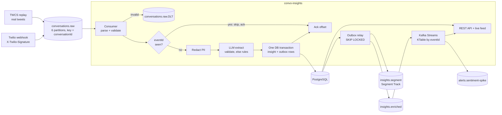
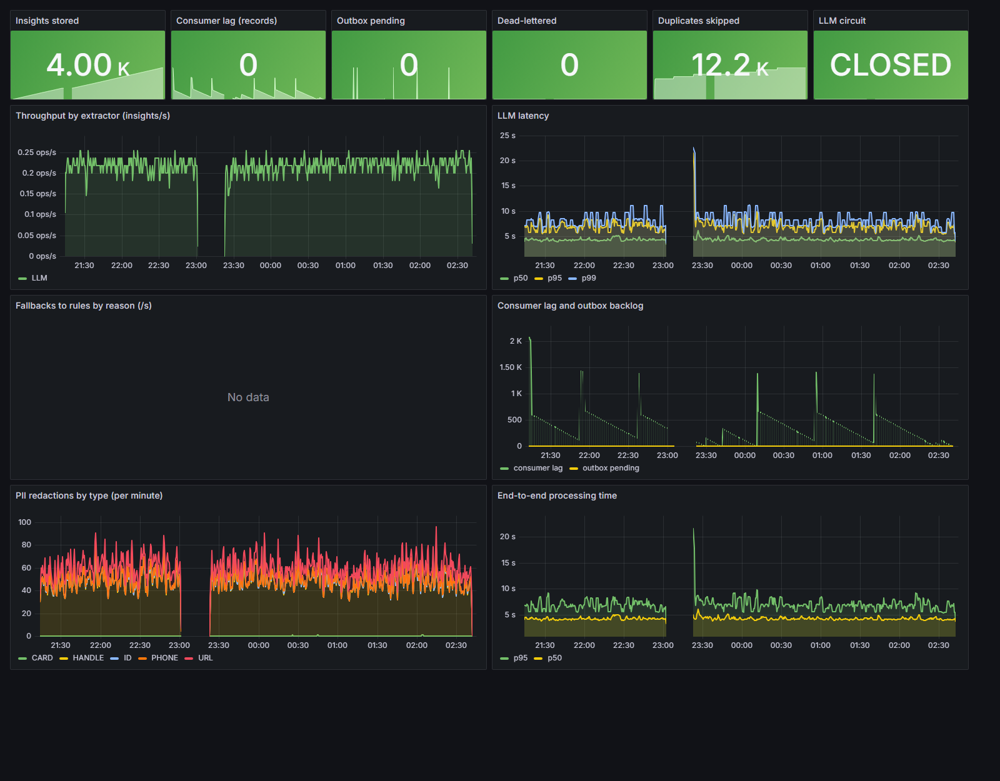
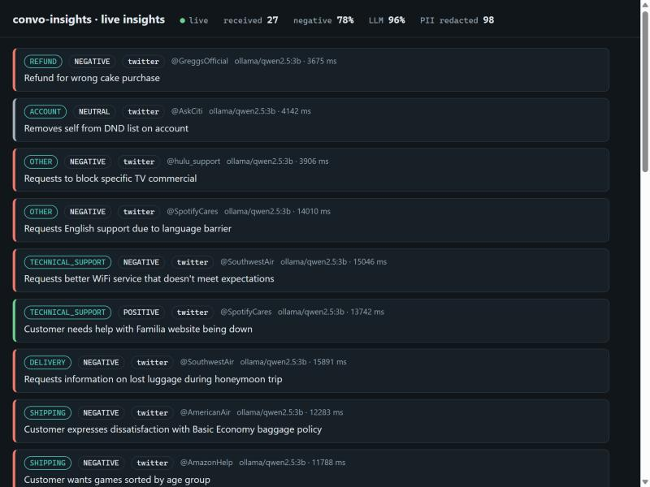

# convo-insights

[](https://github.com/246mayank/convo-insights/actions/workflows/ci.yml)
[](https://github.com/246mayank/convo-insights/actions/workflows/regression-gate.yml)

An event-driven Spring Boot service that turns customer-support conversations into **insights**: intent, sentiment and a one-line summary from an LLM. Conversations come from Kafka or a Twilio Conversations webhook; insights go to PostgreSQL, Kafka, Segment-format events and a REST API, with streaming analytics on top.

The design goal is that **no conversation is lost or counted twice, even when the service is killed mid-stream**. Every claim below links to the run that measured it.

| | |
|---|---|
| Real conversations through the LLM | **4,000 / 4,000**, 0 fallbacks, 0 dead-lettered ([run](bench/run-official.md)) |
| Hard kills (`kill -9`) during a replay | **6 mid-stream → 3,000 / 3,000 stored, 0 duplicates** ([chaos run](bench/chaos-20261021-204552.md)) |
| Intent accuracy, LLM vs keyword rules | **86.0% vs 62.0%** synthetic, **43.8% vs 33.3%** on real hand-labelled tweets ([bake-off](eval/BAKEOFF.md)) |
| Streaming analytics vs the database | **3,859 brand-day buckets, 0 mismatches** with every event delivered twice ([check](bench/analytics-20261023.md)) |
| Read API under load | **500 req/s, 0 failures, p95 19.4 ms** ([k6](bench/k6.md)) |
| Tests | **112** (103 unit, 9 against real Kafka + PostgreSQL), plus a CI gate that [blocked a bad prompt](https://github.com/246mayank/convo-insights/pull/1) |

## Why it is shaped like this

Each feature is a small, honest version of something Twilio runs:

| Twilio | Here |
|---|---|
| **Conversation Intelligence** (language operators: summary, sentiment, classification, PII redaction) | LLM extraction behind a provider-agnostic interface, schema-validated, PII redacted before inference, versioned prompts scored in CI |
| **Cross-Channels / Conversations API** | A signed `onMessageAdded` webhook (SMS, WhatsApp, chat) feeding the same pipeline as the Twitter replay |
| **Segment** (Track calls, `messageId` dedupe, profiles and computed traits) | Every insight becomes a `Conversation Analyzed` Track call with `messageId = eventId`; Kafka Streams keeps customer profiles |
| **Reliability** | Ack after commit, unique-key dedupe, transactional outbox, circuit breaker, dead-letter topic with a re-drive tool, chaos-tested |

## Architecture



**One message, step by step**

1. A conversation arrives on `conversations.raw`, keyed by conversationId so its updates stay in order on one partition.
2. The consumer parses and validates it. Anything unparseable goes straight to the dead-letter topic; other failures get 3 retries with backoff (1 s, 2 s, 4 s) first.
3. If its `eventId` (a SHA-256 content hash) is already stored, it's a redelivery: skip and ack.
4. Personal data is replaced with tags (`[EMAIL]`, `[PHONE]`, Luhn-checked `[CARD]`, `[ID]`, `[HANDLE]`) before any model sees it.
5. The LLM answers in a JSON schema. Every field is validated; a late, broken or invalid answer falls back to keyword rules, and the reason is stored (`MALFORMED_JSON`, `SCHEMA_VIOLATION`, `TIMEOUT`, `HTTP_ERROR`, `CIRCUIT_OPEN`).
6. One transaction writes the insight and two outbox rows (enriched insight, Segment Track call). Only then is the Kafka offset acked.
7. The relay publishes outbox rows, waits for broker acks and marks them sent. Several relays can run at once (`FOR UPDATE SKIP LOCKED`).

## Delivery semantics

- **At-least-once in, exactly one row stored.** Offsets are committed manually after the DB commit, so a crash means redelivery, never loss. The unique index on `event_id` turns redelivery into a no-op; a racing duplicate loses the insert and reuses the winner's row.
- **No dual write.** Postgres and Kafka can't share a transaction, so the publish intent is an outbox row in the same transaction as the insight. A crash before the relay runs leaves it pending (sent later); a crash between send and mark re-sends it. Downstream is at-least-once, keyed by eventId. Segment dedupes on `messageId`, which is the eventId.
- **Exactly-once where it really applies.** The Kafka-to-Kafka analytics run with `exactly_once_v2`, and they aggregate from a KTable keyed by eventId, so a re-sent insight replaces its earlier version instead of being counted again.
- **Fast recovery.** `session.timeout.ms` is 10 s, so a killed consumer's partitions move in about 17 s including JVM start ([measured](bench/chaos-20261021-204552.md)).

Full reasoning: [docs/adr](docs/adr).

## Features

| Feature | Where | Proof |
|---|---|---|
| LLM extraction (Ollama, Qwen 2.5 3B, CPU) with schema validation and rules fallback | `extract/llm/` | [bake-off](eval/BAKEOFF.md), [official run](bench/run-official.md) |
| Second provider (Gemini) behind the same `LlmClient` interface | `GeminiClient` | unit tests |
| PII redaction before inference | `privacy/PiiRedactor` | unit + property tests (jqwik), integration test |
| Circuit breaker around the model (resilience4j) | `CircuitBreakingLlmClient` | unit tests |
| Transactional outbox + relay | `outbox/` | integration tests, chaos run |
| Dead-letter topic + re-drive tool | `KafkaErrorHandlingConfig`, `RedriveRunner` | integration test |
| Twilio Conversations webhook, signature checked | `ingest/twilio/` | cross-checked against `twilio-java`'s `RequestValidator`; integration tests |
| Segment Track output with a JSON-schema contract | `SegmentTrack`, `contracts/` | contract test |
| Kafka Streams: brand sentiment by event-time day, spike alerts, customer profiles, interactive queries | `analytics/` | `TopologyTestDriver` tests, [reconciliation](bench/analytics-20261023.md) |
| OpenTelemetry tracing, carried across the outbox | `OutboxTracing` | [one trace, 9 spans](bench/trace-20261023.md) |
| Metrics, Prometheus, Grafana dashboard | `InsightMetrics`, `ops/` | [dashboard of the official run](docs/img/dashboard.png) |
| Regression gate in CI | `.github/workflows/regression-gate.yml` | [failed run on a bad prompt](https://github.com/246mayank/convo-insights/actions/runs/39924232090) |
| Live feed (SSE) | `/live.html` | [screenshot](docs/img/live.jpg) |

## What it looks like

The official run in Grafana: 4,000 conversations, consumer lag draining to 0, model latency steady (p95 6.8 s measured from the stored rows), circuit closed, nothing dead-lettered. The 23:00–23:22 gap is the laptop going to sleep; the service recovered without help.



One webhook, one trace: HTTP → Kafka → consumer → model call (2.99 s) → outbox → downstream.


Insights arriving live:



## Model quality

Scored by `EvalMain` on two labelled sets:

| Extractor | Golden (200 synthetic) | Real tweets (48 hand-labelled) | Real sentiment | p95, real |
|---|---:|---:|---:|---:|
| **qwen2.5:3b** (default) | **86.0%** | **43.8%** | 70.8% | 5.2 s |
| qwen2.5:1.5b | 72.5% | 25.0% | 79.2% | 3.0 s |
| keyword rules | 62.0% | 33.3% | 56.2% | |
| qwen2.5:0.5b | 35.5% | 8.3% | 56.2% | 1.4 s |

The real-tweet set is small (one row is about 2 points), and it was used while tuning a prompt, so it's a development set. Prompt v2 scored lower and was rejected; see [BAKEOFF.md](eval/BAKEOFF.md).

The **regression gate** scores the production model and prompt on 60 golden rows on every pull request, and fails if accuracy drops more than 5 points or p95 latency rises more than 50% against [eval/baseline.json](eval/baseline.json) (86.7%, 3,979 ms on the GitHub runner). [PR #1](https://github.com/246mayank/convo-insights/pull/1) removed the intent definitions from the prompt; accuracy fell to 25.0% and the gate failed it.

## Run it

Requires JDK 21, Docker and [Ollama](https://ollama.com) (`ollama pull qwen2.5:3b`).

```bash
docker compose up -d                                   # Kafka (KRaft) + PostgreSQL
./mvnw -DskipTests package
java -jar target/convo-insights-0.0.1-SNAPSHOT.jar     # consumer, relay, analytics, REST on :8080

# threads the Kaggle TWCS corpus into conversations (data is not in this repo)
python scripts/build_conversations.py path/to/twcs.csv data/conversations.jsonl --limit 5000
java -jar target/convo-insights-0.0.1-SNAPSHOT.jar --spring.profiles.active=replay \
     --replay.file=data/conversations.jsonl --replay.limit=100

docker compose --profile observability up -d           # Prometheus :9090, Grafana :3000, Jaeger :16686
java -jar target/convo-insights-0.0.1-SNAPSHOT.jar --spring.profiles.active=tracing
```

Run without a model with `--insights.llm.provider=rules`, or with Gemini via `--insights.llm.provider=gemini` and `GEMINI_API_KEY` set. The webhook needs `TWILIO_AUTH_TOKEN` and `TWILIO_WEBHOOK_URL` (the exact public URL Twilio calls, since the signature covers it).

| Endpoint | |
|---|---|
| `GET /api/insights?intent=&sentiment=&brand=&conversationId=&page=&size=` | Search |
| `GET /api/insights/{eventId}` · `GET /api/insights/stats` | One insight · counts by intent, sentiment, extractor |
| `GET /api/brands/{brand}/sentiment?from=&to=` | Daily sentiment (Kafka Streams interactive query) |
| `GET /api/profiles/{customerId}` | Customer profile with computed traits |
| `POST /webhooks/twilio/conversations` | Twilio Conversations webhook |
| `GET /api/insights/stream` · `/live.html` | Server-sent events · live page |
| `/swagger-ui.html` · `/actuator/prometheus` · `/actuator/health` | API docs · metrics · health |

Tools: `scripts/chaos.sh` (kill -9 during a replay, then reconcile), `scripts/pilot.sh` (throughput with the real model), the `redrive` profile (inspect and re-publish dead letters), the `republish` profile (re-queue stored insights), `ops/k6/read-api.js` (load test).

## Tests

```bash
./mvnw test      # 103 unit tests, no Docker
./mvnw verify    # + 9 Testcontainers integration tests (real Kafka + PostgreSQL)
```

The integration tests use a scripted fake model and cover the happy path, a duplicate delivery, malformed model output, a poison record going to the dead-letter topic, PII never reaching the model, **the offset not moving while PostgreSQL is paused**, and signed and badly signed webhooks. ArchUnit rules keep the layers apart (for example, the REST layer may not publish to Kafka, and only the outbox, tools and ingest may use `KafkaTemplate`).

They found real bugs, each fixed and explained in the commit history:
- Spring Kafka doesn't commit a dead-lettered record's offset under manual acks unless `commitRecovered` is set.
- `@KafkaListener(id=…)` silently replaces the configured consumer group.
- An old `commons-io` from the Twilio SDK broke Testcontainers.
- The gate step swallowed its own failure without `pipefail`.

## Data

- **Replay:** [Customer Support on Twitter](https://www.kaggle.com/datasets/thoughtvector/customer-support-on-twitter) (TWCS), 2.8 M real tweets, CC BY-NC-SA 4.0. Not redistributed here; only event ids and hand labels are committed (`eval/twcs-labels.jsonl`).
- **Golden set:** a 200-row stratified sample of the [Bitext customer-support dataset](https://huggingface.co/datasets/bitext/Bitext-customer-support-llm-chatbot-training-dataset) (synthetic, CDLA-Sharing-1.0), customer turns only, so the agent replies can't leak the label.

## Limitations

- CPU-only model: about 0.2 conversations/s. More consumer threads only queue inside Ollama ([pilot](bench/pilot.md)); production needs GPU serving or a hosted model.
- Real-tweet intent accuracy (43.8%) is far below synthetic accuracy; real threads mix several issues and venting.
- Single broker, replication factor 1. JSON messages without a schema registry.
- The analytics KTable keeps every eventId forever; production needs retention.
- The webhook is tested with correctly signed fixtures, not live Twilio traffic.

## What I'd do next

GPU or hosted model serving with batching; a schema registry (Avro or Protobuf); 3 brokers with replication factor 3; retention on the analytics state; SLOs with alerts on consumer lag and fallback rate; per-region PII policy; a larger held-out real-tweet test set.

## Layout

```
src/main/java/dev/mayank/convoinsights/
  domain/      events, insights, enums              ingest/     consumer, service, DLT, webhook, Segment
  extract/     rules + LLM extractors, validator    outbox/     outbox, relay, tracing across it
  privacy/     PII redaction                        analytics/  Kafka Streams topology + queries
  api/         REST + live feed                     replay/     replay, re-drive, republish tools
  eval/        offline eval + CI gate
src/main/resources/db/migration   Flyway V1..V6
src/main/resources/prompts        versioned prompts
bench/  eval/  contracts/  ops/  scripts/  docs/
```
