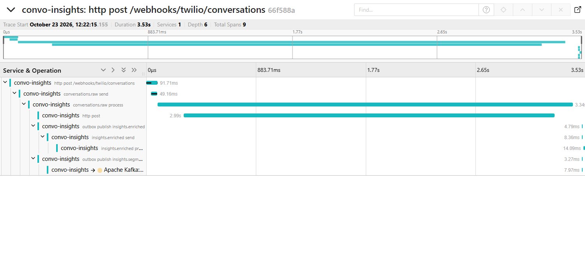

# One trace across the pipeline

A signed Twilio Conversations webhook (SMS, 2 messages) sent to the service running with `--spring.profiles.active=tracing`
(OTLP to Jaeger 1.62, qwen2.5:3b). Trace `66f588a3d2442aabcec01ba0ee2b8e58`, 9 spans, 3.53 s:

```
  http post /webhooks/twilio/conversations                    91.7 ms
  conversations.raw send                                      49.2 ms
  conversations.raw process                                 3342.6 ms
  http post                                                 2990.1 ms
  outbox publish insights.enriched                             4.8 ms
  outbox publish insights.segment                              3.3 ms
  insights.segment send                                        8.0 ms
  insights.enriched send                                       8.4 ms
  insights.enriched process                                   14.1 ms
```

The hop through the transactional outbox keeps the trace: the consumer's transaction stores its W3C
`traceparent` on each outbox row (Flyway V6), and the relay, which runs later on its scheduler thread,
starts its publish span as a child of it (`OutboxTracing`). Kafka producer/consumer spans come from
spring-kafka observation; the model call is the `http post` client span from the observed RestClient.


